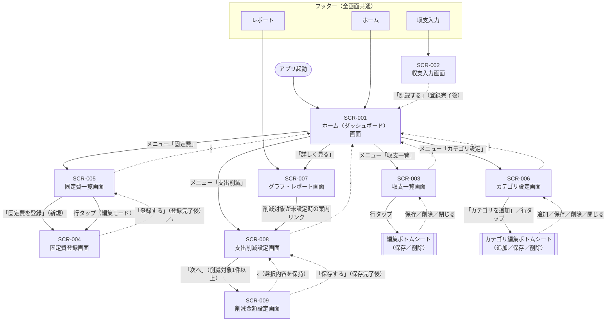

# 家計簿アプリ 要件定義書

## 第4章 画面遷移図（一次開発）

[画面一覧書](03_画面一覧書.md)で定義した9画面（SCR-001〜SCR-009）の遷移を整理する。各画面のレイアウトは[ワイヤフレーム](10_ワイヤフレーム.html)を参照。

---

### 1. 画面遷移図

- 実線：前に進む遷移　／　点線：登録完了後に戻る遷移、または左上の「‹」で戻る遷移
- 編集ボトムシート・カテゴリ編集ボトムシートは独立した画面ではなく、それぞれSCR-003・SCR-006の上に重ねて表示する部品である
- フッターは全画面に表示されるため、どの画面からでもSCR-001・SCR-002・SCR-007へ移動できる（図では個別の矢印を省略）

---

### 2. フッター（全画面共通）

| ボタン | 遷移先 |
|---|---|
| ホーム | SCR-001 ホーム（ダッシュボード）画面 |
| 収支入力 | SCR-002 収支入力画面 |
| レポート | SCR-007 グラフ・レポート画面 |

SCR-003〜SCR-006、SCR-008、SCR-009はフッターに対応するボタンがないため、表示中はフッターのどのボタンも選択状態にしない。

---

### 3. 画面内の遷移

| 遷移元 | 操作 | 遷移先 |
|---|---|---|
| （起動時） | アプリを開く | SCR-001 |
| SCR-001 | メニュー「収支一覧」 | SCR-003 |
| SCR-001 | メニュー「固定費」 | SCR-005 |
| SCR-001 | メニュー「カテゴリ設定」 | SCR-006 |
| SCR-001 | メニュー「支出削減」 | SCR-008 |
| SCR-001 | 月次収支推移の「詳しく見る」 | SCR-007 |
| SCR-002 | 「記録する」ボタン（登録完了後） | SCR-001（「続けて入力」ON時はSCR-002に留まる） |
| SCR-003 | 一覧の行をタップ | 編集ボトムシート（SCR-003上に表示） |
| SCR-005 | 「固定費を登録」ボタン | SCR-004（新規登録） |
| SCR-005 | 一覧の行をタップ | SCR-004（編集モード） |
| SCR-004 | 「登録する」／「削除」ボタン（完了後） | SCR-005 |
| SCR-006 | 「＋ カテゴリを追加」ボタン | カテゴリ編集ボトムシート（新規・SCR-006上に表示） |
| SCR-006 | 自分が作成したカテゴリの行をタップ | カテゴリ編集ボトムシート（編集・SCR-006上に表示） |
| SCR-007 | 「削減対象」タブで未設定時の案内リンク | SCR-008 |
| SCR-008 | 「次へ」ボタン（削減対象が1件以上。0件はエラー） | SCR-009 |
| SCR-009 | 「保存する」ボタン（保存完了後） | SCR-008 |

---

### 4. 戻る操作

| 画面 | 左上の「‹」 | フッターの「ホーム」 |
|---|---|---|
| SCR-003 収支一覧 | SCR-001 | SCR-001 |
| SCR-004 固定費登録 | SCR-005 | SCR-001 |
| SCR-005 固定費一覧 | SCR-001 | SCR-001 |
| SCR-006 カテゴリ設定 | SCR-001 | SCR-001 |
| SCR-008 支出削減設定 | SCR-001 | SCR-001 |
| SCR-009 削減金額設定 | SCR-008（SCR-008での選択内容を保持） | SCR-001（フッターの「ホーム」） |

SCR-001・SCR-002・SCR-007はフッターから直接開く画面のため、左上の「‹」は表示しない。
