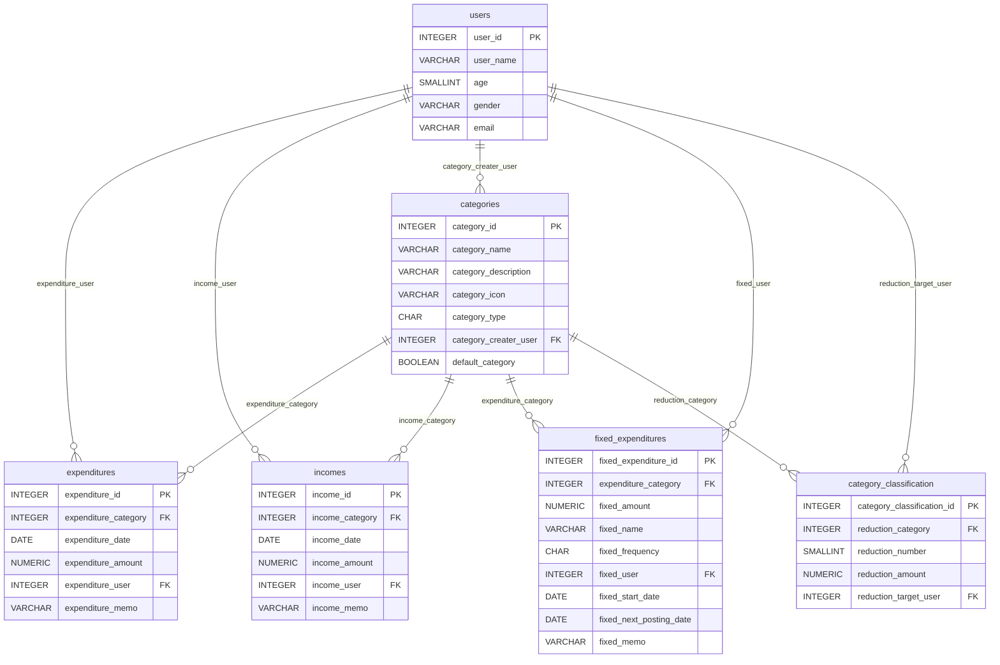

# 家計簿アプリ 要件定義書

## 第8章 ER図（一次開発）

[テーブル定義書](07_テーブル定義書.md)で定義した6テーブル（users / expenditures / incomes / categories / fixed_expenditures / category_classification）の関係性を整理する。

---

### 1. ER図

---

### 2. 補足：category_classificationについて

category_classificationは、usersテーブルとcategoriesテーブルの中間テーブル（多対多の関連を表現するテーブル）である。「どのユーザーが」「どのカテゴリーを」削減対象としているかを、reduction_target_user（users側FK）とreduction_category（categories側FK）の組み合わせで表す。削減の優先度（reduction_number）と、1か月あたりに削減してよい金額（reduction_amount）もこのテーブルに持つ。

---

### 3. 関連の一覧

| 親テーブル | 子テーブル | 子テーブルのFKカラム | カーディナリティ | 補足 |
|---|---|---|---|---|
| users | expenditures | expenditure_user | 1 : 多 | 1人のユーザーが複数の支出データを持つ |
| users | incomes | income_user | 1 : 多 | 1人のユーザーが複数の収入データを持つ |
| users | categories | category_creater_user | 1 : 多 | 1人のユーザーが複数のカテゴリーを作成できる |
| categories | expenditures | expenditure_category | 1 : 多 | 1つのカテゴリーが複数の支出データに紐づく（category_typeが「01」のカテゴリのみを想定） |
| categories | incomes | income_category | 1 : 多 | 1つのカテゴリーが複数の収入データに紐づく（category_typeが「02」のカテゴリのみを想定） |
| categories | fixed_expenditures | expenditure_category | 1 : 多 | 1つのカテゴリーが複数の固定費データに紐づく |
| users | fixed_expenditures | fixed_user | 1 : 多 | 1人のユーザーが複数の固定費データを持つ |
| users | category_classification | reduction_target_user | 1 : 多 | 1人のユーザーが複数のカテゴリーを削減対象として設定できる |
| categories | category_classification | reduction_category | 1 : 多 | 1つのカテゴリーが複数ユーザーから削減対象として設定されうる |
