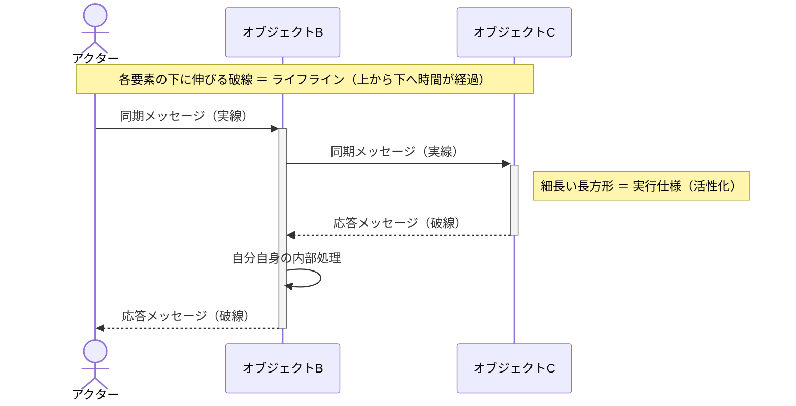
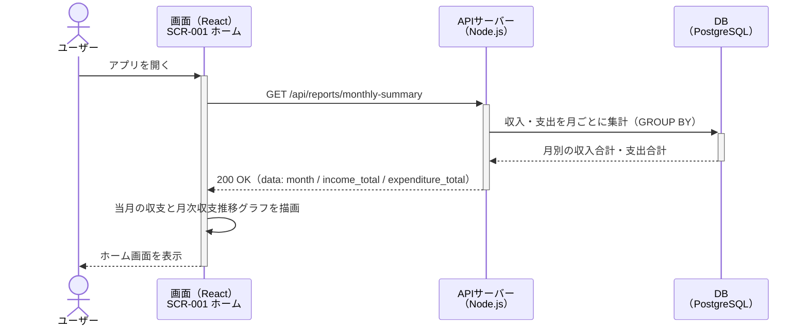
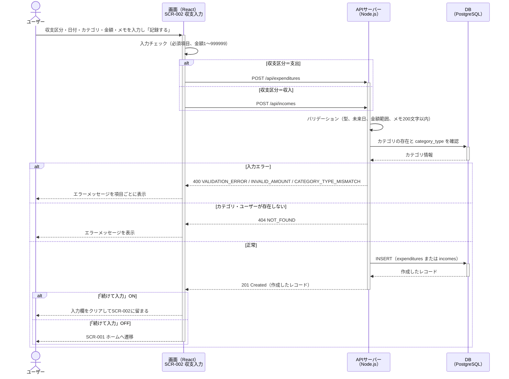
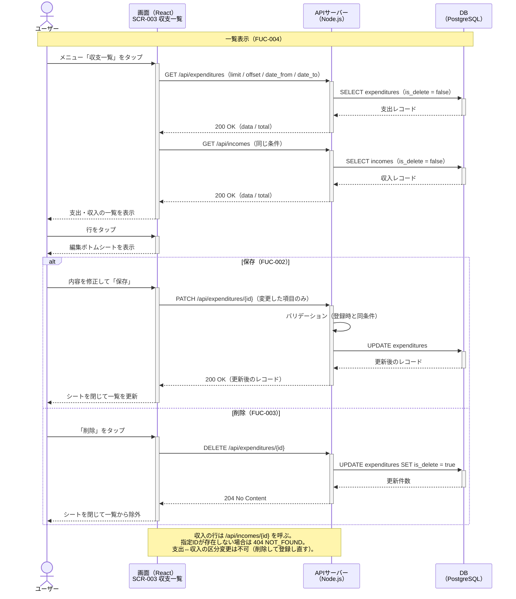
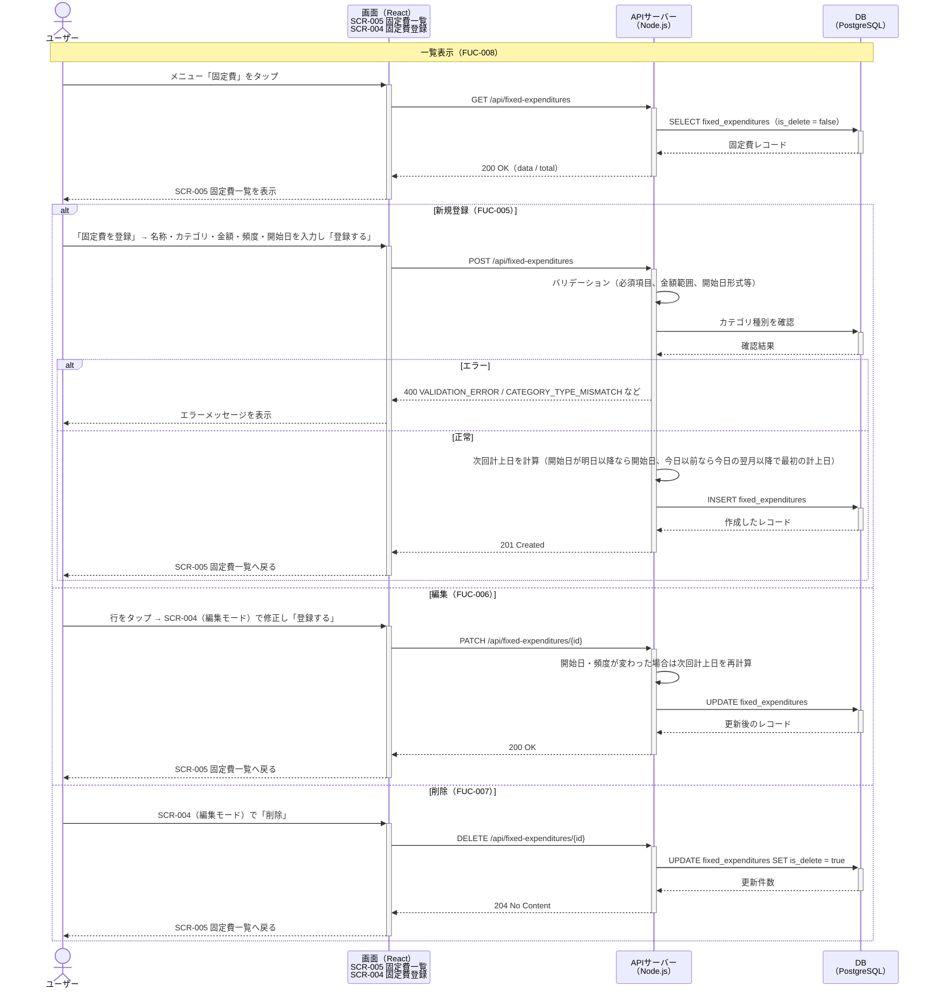
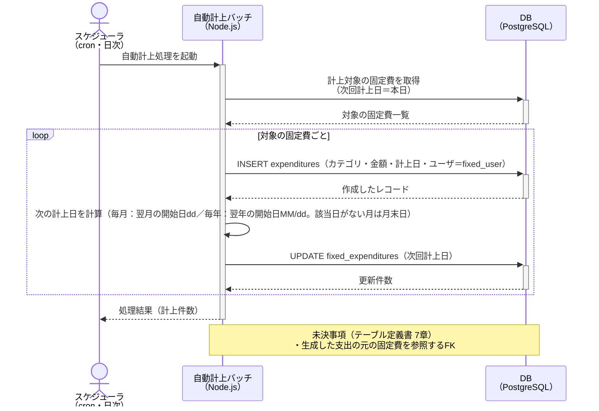
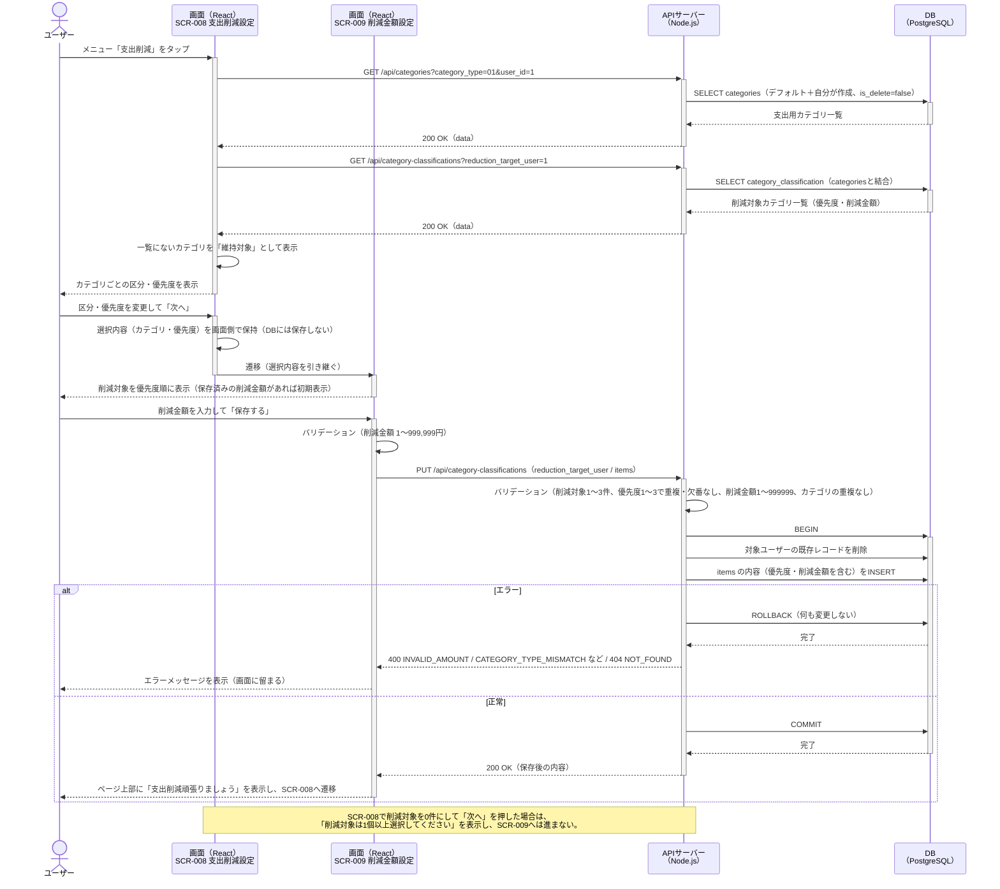
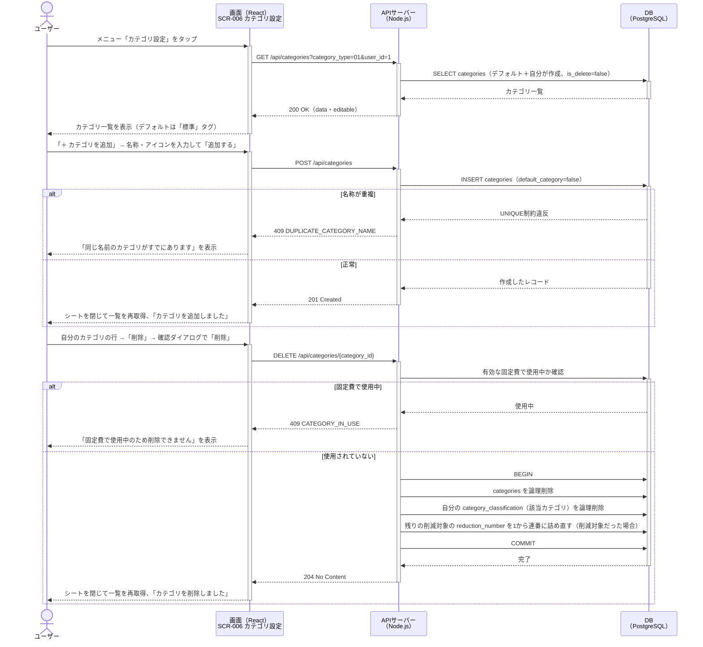
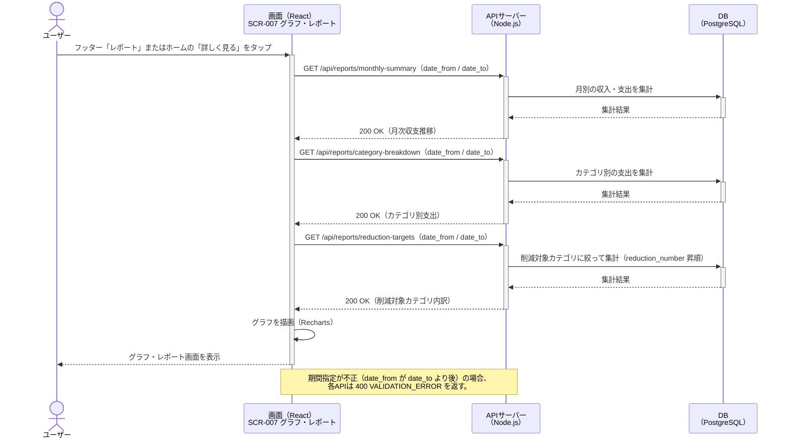

# 家計簿アプリ 要件定義書

## 第13章 シーケンス図（一次開発）

[画面一覧書](03_画面一覧書.md)・[機能一覧書](05_機能一覧書.md)・[API仕様書](09_API仕様書.md)・[テーブル定義書](07_テーブル定義書.md)をもとに、各機能（FUC-001〜013）の処理の流れを時系列で整理する。[システム全体概要書](00_システム全体概要書.md) 12章のとおり、操作フロー図の代わりとして本書を用いる。

---

### 0. 凡例

#### 0-1. 構成要素

| 構成要素 | 図での表し方 | 説明 | 本書での例 |
|---|---|---|---|
| アクター | 人型のアイコン | システムを利用する人間や外部システム | ユーザー、スケジューラ（cron） |
| オブジェクト | 四角い箱 | 処理を行う画面やサーバー、データベースなどの実体 | 画面（React）、APIサーバー（Node.js）、DB（PostgreSQL） |
| ライフライン | オブジェクトから下へ伸びる垂直の破線 | 時間の経過を表す（上から下へ時間が進む） | 各アクター・オブジェクトの下に伸びる線 |
| 実行仕様（活性化） | ライフライン上の細長い長方形 | 処理を実行している期間を示す | APIサーバーがリクエストを処理している間 |
| メッセージ（同期） | 実線の矢印（──▶） | 呼び出し元が応答を待つ指示・データの送信 | `POST /api/expenditures` |
| メッセージ（応答） | 破線の矢印（--▶） | 同期メッセージに対する戻り値・結果 | `201 Created` |

#### 0-2. 補助的な表記

| 表記 | 説明 |
|---|---|
| `alt` / `else` の枠 | 条件分岐。枠内のいずれか1つだけが実行される（例：入力エラー時／正常時） |
| `loop` の枠 | 繰り返し処理 |
| 自分自身への矢印 | オブジェクト内部の処理（入力チェック、画面描画など） |
| 黄色の付箋（Note） | 補足説明・未決事項 |

#### 0-3. 凡例図

#### 0-4. 本書に登場するアクター・オブジェクト

| 種別 | 名称 | 内容 | 根拠資料 |
|---|---|---|---|
| アクター | ユーザー | スマートフォンのブラウザから家計簿を操作する利用者（単一ユーザー） | [MVP範囲書](02_MVP範囲書.md)、[システム全体概要書](00_システム全体概要書.md) 11章 |
| アクター | スケジューラ（cron） | 固定費自動計上を定期起動する外部の仕組み（日次バッチ） | [API仕様書](09_API仕様書.md) 3-5 |
| オブジェクト | 画面（React） | SCR-001〜SCR-009。Vercelから配信される | [画面一覧書](03_画面一覧書.md)、[デプロイ・インフラ方針書](11_デプロイ・インフラ方針書.md) |
| オブジェクト | APIサーバー（Node.js） | `/api/*` を提供する。Render上で稼働する | [API仕様書](09_API仕様書.md) |
| オブジェクト | 自動計上バッチ | FUC-009を実行するバックグラウンド処理（画面なし） | [API仕様書](09_API仕様書.md) 3-5 |
| オブジェクト | DB（PostgreSQL） | 本番はNeon、開発はDocker | [テーブル定義書](07_テーブル定義書.md) |

※ 一次開発は認証なし（[API仕様書](09_API仕様書.md) 0-2）のため、ログイン処理は図に含めない。

---

### 1. ホーム画面表示（SCR-001 / FUC-011）

アプリ起動時にホーム画面を開き、当月の収支と月次収支推移を表示する。

---

### 2. 支出・収入登録（SCR-002 / FUC-001）

支出と収入は別エンドポイントのため、選択した収支区分によって呼び出すAPIが変わる。

---

### 3. 収支一覧表示・編集・削除（SCR-003 / FUC-002〜004）

一覧の行をタップすると編集ボトムシート（SCR-003の上に重ねて表示する部品）が開き、保存または削除を行う。

---

### 4. 固定費の一覧表示・登録・編集・削除（SCR-005・SCR-004 / FUC-005〜008）

---

### 5. 固定費自動計上（バックグラウンド処理 / FUC-009）

画面を持たない処理のため、ユーザーではなくスケジューラ（cron）が起点となる。計上結果はSCR-001・SCR-003に反映される。

---

### 6. 支出削減設定（SCR-008・SCR-009 / FUC-010, FUC-014）

category_classificationにレコードがあるカテゴリを「削減対象」、ないカテゴリを「維持対象」として扱う。SCR-008で削減対象・優先度を選び、SCR-009で削減金額を入力して「保存する」で一括置き換えする。SCR-008からSCR-009へ進む時点ではDBに保存しない。

---

### 6-2. カテゴリ設定（SCR-006 / FUC-015〜018）

カテゴリの追加・編集・削除はSCR-006上のカテゴリ編集シートで行う。編集・削除できるのは自分が作成したカテゴリのみ。

---

### 7. グラフ・レポート表示（SCR-007 / FUC-011〜013）

いずれも読み取り専用の集計APIで、集計はDB側（GROUP BY）で行う。

---

### 8. 本書の対象外

| 対象 | 理由 |
|---|---|
| ユーザ管理API（[API仕様書](09_API仕様書.md) 6章） | 対応する画面が[画面一覧書](03_画面一覧書.md)にないため。画面追加時に本書へ追記する |
| ログイン処理 | 一次開発は認証なしのため（二次開発でJWT導入予定） |
| 管理者向けの手動計上API | [API仕様書](09_API仕様書.md) 3-5で「必要になった場合に追記」とされているため |
